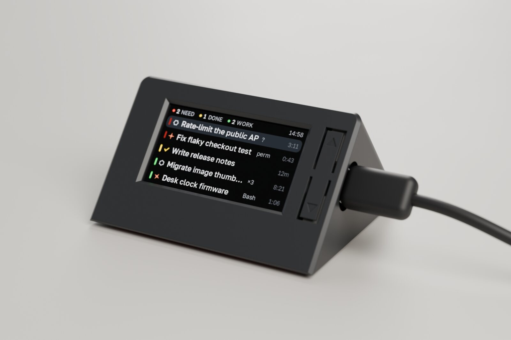
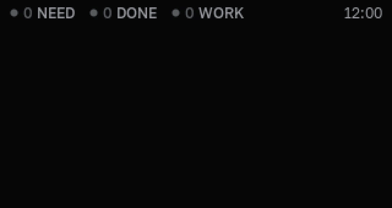
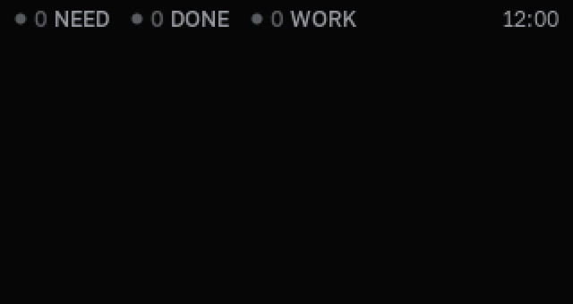
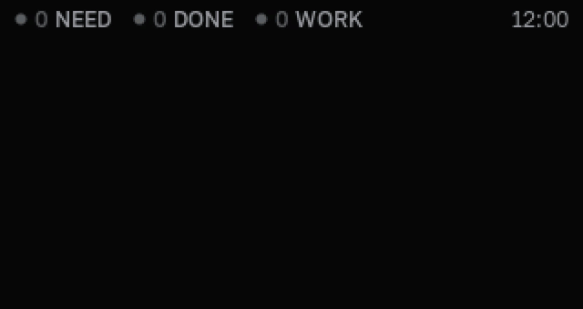
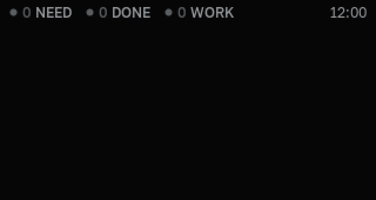
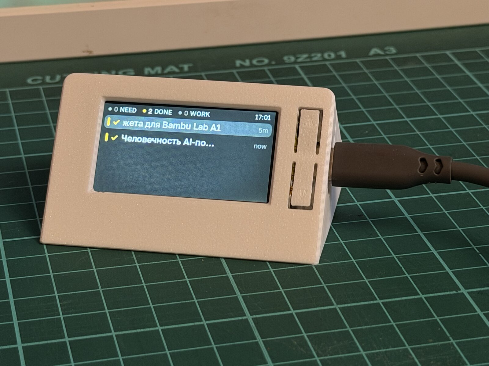

# desksessions



A small desk display that shows your running Claude Code and Codex sessions: which ones are
working, which are done, and which are waiting for you.

It has two halves:

- **The clock**: a Heltec Vision Master T190 (ESP32-S3, 1.9" 170×320 TFT, two buttons) running
  the firmware in `firmware/`.
- **The Mac app**: a menu-bar app in `mac/` that watches your sessions and sends them to the
  clock over Bluetooth LE. It also has its own panel (⌥⌘S) with the same list.

The buttons on the clock move the cursor, dismiss a finished session, or jump to the selected
session on the Mac.

| | |
|---|---|
|  |  |
| Moving the cursor with the two buttons | Hold to dismiss a finished session |
|  |  |
| Nothing left to do | The Mac goes to sleep and wakes up |



The motion borrows from Pebble and Apple; the timings are in `docs/DESIGN.md`, and
[Thirty-three milliseconds](https://georgii.cc/thirty-three-milliseconds) is the story of
building it.

## Layout

```
docs/DESIGN.md   design decisions: states, UI, motion, architecture
protocol/        the BLE frame format, with a golden frame both sides test against
firmware/        Rust: portable core and renderer, device build, simulator, golden tests
mac/             Swift package: menu-bar app, Codex hook binary, tests
```

## Firmware

Rust. The simulator and tests need only stable Rust (`rustup`); recordings need `ffmpeg`. The
device build needs the Xtensa toolchain (`cargo install espup espflash && espup install`, then
`. ~/export-esp.sh` in each shell).

```
cd firmware
cargo test                       # unit tests, wire vectors, curves, golden scenarios
cargo run --release -p desk-sim  # the simulator; ↑/↓ are the two buttons, hold for a long press
tools/check.sh                   # every gate: fmt, clippy, tests, device builds

cd device
cargo run --release              # build, flash the clock and watch its serial output
```

`--features demo` builds the device with a scripted pretend Mac instead of Bluetooth,
`--features stats` prints frame timing over USB serial every 5 s, and `--features overlay` draws
the frame rate, drawing time and a chart of the last two seconds of frames over the picture.

Flashing replaces the stock firmware on the board. Coming from the earlier C++ firmware, pair
again once: on the Mac, forget the clock in Bluetooth settings, then pair it from the app.

Simulator options: `--no-demo`, `--no-backlight`, `--slowmo <factor>`, `--time HH:MM`,
`--seconds <n>`, `--gif <file>`, `--shots <dir> --at <ms,ms,...>`, `--headless`, `--overlay`, and
`--script <ms:cue,...>` with cues `up`, `down`, `longup`, `longdown`, `add`, `remove`, `needs`,
`pause`, `link`, `sleep`, `pair`, `empty`.

## Mac app

Needs macOS 26 and Xcode with Swift 6.2 or newer.

```
cd mac
swift test
scripts/build-app.sh             # builds build/DeskSessions.app, ad-hoc signed
scripts/build-app.sh --install   # also copies it to ~/Applications and launches it
```

Pair the clock from the app's settings: the clock shows a six-digit code, type it on the Mac.
To pair again, hold both buttons on the clock for 5 seconds.

Claude Code sessions are picked up from `~/.claude/sessions`. Codex needs hooks, which the
settings window installs into `~/.codex/hooks.json` (and removes again) without touching other
entries.

## License

MIT, see `LICENSE`. The UI font is [Golos Text](https://fonts.google.com/specimen/Golos+Text) under the SIL
Open Font License; see `firmware/fonts/OFL.txt`.
